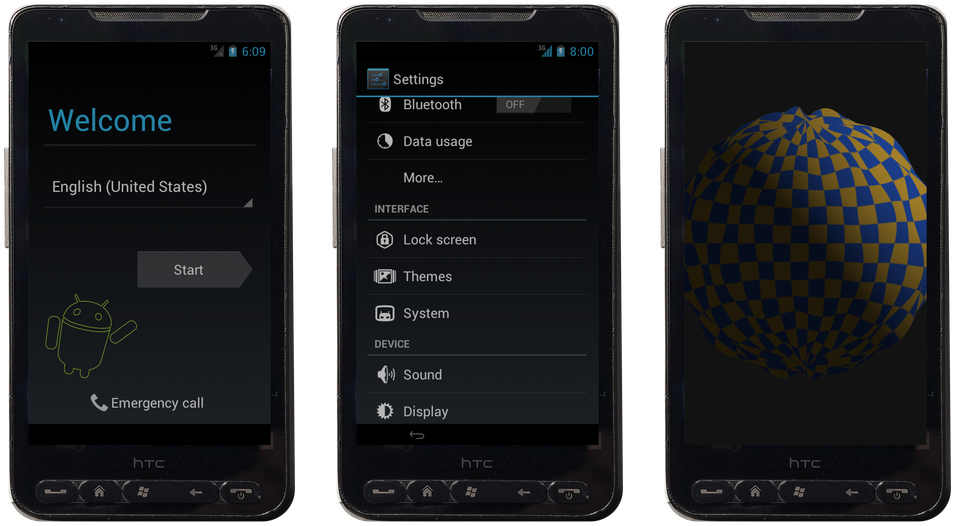
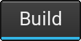
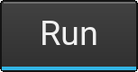
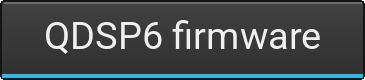
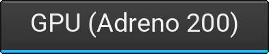

<h1 align="center">HTC HD2 on QEMU</h1>

<p align="center">
  
  
  
  
</p>

<p align="center">
  
</p>

<p align="center">
  <a href="#build"></a>
  <a href="#run"></a>
  <a href="#what-works"></a>
  <a href="#real-baseband-firmware"></a>
  <a href="#gpu-adreno-200"></a>
  <a href="#tools"></a>
</p>

> [!WARNING]
> **Vibecoded.** This project was written FULLY by an AI coding agent (Claude), with little (actually 0) human review. Expect bullshit, don't ask me about this (i really don't know how it works either).

A QEMU machine (`-M htcleo`) that emulates the HTC HD2 (Qualcomm QSD8250) hardware. It boots whatever is in its NAND, unmodified, the way the phone would.

<a name="build"></a>
<h2></h2>

```bash
mkdir -p src/qemu/build && cd src/qemu/build
../configure --target-list=arm-softmmu,hexagon-softmmu --enable-sdl \
    --disable-docs --disable-werror --disable-gtk --disable-xen --disable-kvm \
    --disable-tools --disable-guest-agent
ninja qemu-system-arm qemu-system-hexagon
```

The machine is in `src/qemu/hw/arm/htcleo/`.

<a name="images"></a>
<h2></h2>

`images/nand.img` is the phone's raw 512 MiB NAND: a dump of your own, or one built from a bootloader and a NAND ROM zip:

```bash
cd images
python3 ../tools/hd2_mknand.py --nbh LEOIMG.nbh --rom rom.zip -o nand.img   # or --lk lk.bin
../tools/mksdcard.sh sdcard.img 1024                                        # optional microSD (FAT32)
```

`hd2_mknand.py` lays the NAND out as a flashed phone would have it: the bootloader in the OS area, the partition table, the ROM installed (boot.img and yaffs2 `/system` and `/data`) and the factory WiFi/BT MAC addresses. Other options:
- `--recovery recovery.img` adds a recovery image;
- `--system-mb`, `--cache-mb` set the partition sizes;
- `--wifi-mac`, `--bt-mac` set the MACs (`tools/hd2_setmac.py` changes them in an existing image);
- `--gpu` renders with the emulated Adreno GPU instead of in software (see [GPU](#gpu-adreno-200)).

<a name="run"></a>
<h2></h2>

```bash
tools/start.sh                              # start
python3 tools/qmon.py images/qmp.sock quit  # stop
```

- `images/sdcard.img` is attached if present. USB device traffic (e.g. adb) is bridged to 127.0.0.1:5555 (`ADB_PORT`).
- Sound is off by default: `AUDIODEV="-audiodev pa,id=snd0" tools/start.sh` (or `wav,id=snd0,path=out.wav`).
- For a window, drop `-display none` from the script or pass `-display gtk`.
- `web/` is a browser front end (screen, keys, touch, sound, boot options). It needs QEMU built with `-Dvnc=enabled`; run `cd web && npm install && npm run dev` and see `web/README.md`.

| Key | HD2 button |
|---|---|
| PgUp / PgDn | Volume up / down |
| Home / Esc | Home / Back |
| F1 | Windows (Menu) |
| F2 / F3 | Call / End |
| F12 or End | Power |

The mouse is the touchscreen. Headless: `tools/keys.py` and `tools/touch.py` send keys, taps and swipes over QMP.

<a name="what-works"></a>
<h2></h2>

| Block | Emulation |
|---|---|
| CPU | Scorpion as a Cortex-A8 with Qualcomm's MIDR and CP15 registers |
| Core SoC | VIC/SIRC/GPIO interrupts, timers, clocks, NAND + ADM DMA, SDCC microSD |
| Display | MDP 3.1 scanout and PPP blitter |
| GPU | Adreno 200 on the host GPU or the CPU ([below](#gpu-adreno-200)) |
| Modem | Modelled AMSS services (SMEM, proc_comm, SMD, RPC) by default; or the real AMSS firmware ([below](#real-baseband-firmware)) |
| Cellular | T-Mobile US SIM, UMTS registration, data through QEMU's network |
| WiFi | BCM4329; connect to the open network **HD2-QEMU** for internet |
| Bluetooth / FM | BCM4329 HCI (adapter works, no radio links); FM tuner with test tones or `-global bcm4329-bt.fm-stations="MHZ=SOURCE;…"` |
| GPS | 1 Hz fixes; `qom-set /machine/modem gps-fix LAT,LON,ALT` moves the phone |
| Audio | QDSP6 playback to the QEMU audio backend |
| Battery / USB | 1230 mAh gauge that charges and drains; `qom-set /machine cable usb\|ac\|none`, `qom-set /machine battery-capacity N` |
| Input | Touchscreen, key matrix, power key, G-sensor, light sensor, compass |
| USB | HSUSB device controller; adb is bridged to TCP |

Not emulated: camera, audio capture, Bluetooth pairing/connections.

The `qom-set` commands go through `python3 tools/qmon.py images/qmp.sock "..."`.

<a name="real-baseband-firmware"></a>
<h2></h2>

`baseband=lle` runs the radio ROM's AMSS on an emulated ARM926 next to the apps core. The apps side boots on it, the SIM works, and the radio finds no network (the modem DSP runs no code, so there is no RF):

```bash
cd images
python3 ../tools/hd2_radio.py RUU_signed.nbh -o amss.elf
cp nand.img nand-lle.img
python3 ../tools/hd2_radio.py RUU_signed.nbh --write-nand nand-lle.img
cd .. && tools/start-lle.sh
```

The secure boot stages are skipped and their hand-off to AMSS is reproduced. Debugging: `AMSSLOG=1` puts AMSS's debug log in `images/qemu.log`, `TRACE=on` logs the modem's device accesses, fatal errors go to `images/uart1.log`, and `tools/amss_*.py` help with disassembly.

<a name="qdsp6-firmware"></a>
<h3></h3>

With `baseband=lle`, `tools/start-q6.sh` also runs the radio's DSP1 image on the Hexagon QDSP6 in a second process (`qemu-system-hexagon -M htcleo-q6`):

```bash
python3 tools/hd2_radio.py images/RUU_signed.nbh --dsp images/dsp1.elf
tools/start-q6.sh
```

Audio and the hardware H.264 decoder / MPEG-4 encoder then run on the DSP (the encoder's motion search is not modelled). `Q6_AUDIO=none` mutes it; `Q6_MACH=vdc-dump=DIR` saves codec command buffers.

<a name="gpu-adreno-200"></a>
<h2></h2>

The guest's own graphics driver runs on an emulated Adreno 200: command processor, GPU MMU, a2xx shaders, binning into GMEM, and textures including ETC1, ATC, DXT and mipmaps.

Two renderers (`-global msm-adreno.backend=gl|soft`):
- **`gl`** (default) uses the host GPU through OpenGL 4.5, Xenia-style: shaders are translated to GLSL, and GMEM is a GPU buffer the shaders update under fragment shader interlock. Needs `GL_ARB_fragment_shader_interlock` (NVIDIA, recent Intel); otherwise QEMU falls back to `soft`.
- **`soft`** interprets everything on the CPU (`-global msm-adreno.threads=N`).

On an RTX 3080, `gl` draws 8 full-screen blended layers in ~5 ms (`soft`: ~150 ms) and an 18K-triangle mesh in ~3 ms (`soft`: ~49 ms).

`tools/gltri.c` and `tools/gltest.c` are GLES2 test programs. For debugging: `qom-set /machine/gpu trace FILE`, `ADRENO_STATS=SECONDS`, `ADRENO_GL_DEBUG=1`.

<a name="tools"></a>
<h2></h2>

| Tool | Purpose |
|---|---|
| `hd2_mknand.py`, `hd2_setmac.py`, `mksdcard.sh` | NAND and SD images |
| `start.sh`, `start-lle.sh`, `start-q6.sh` | Launch |
| `qmon.py`, `keys.py`, `touch.py` | Monitor commands, input |
| `capture.py`, `waitscreen.py`, `waitlog.sh` | Screendumps, logs |
| `yaffs_check.py`, `logcat.sh` | Read a NAND image's files, guest logs from RAM |
| `hd2_radio.py`, `amss_*.py` | Radio firmware |
| `gltri.c`, `gltest.c` | GPU tests |
| `hd2bench/` | Benchmark app to compare a real HD2 with the emulator |

<a name="credits"></a>
<h2></h2>

The Adreno model builds on [freedreno](https://docs.mesa3d.org/drivers/freedreno.html) (a2xx registers, packets, shader formats), [Xenia](https://xenia.jp) (Xenos shader semantics, texture tiling, and the host-GPU rendering approach) and [texture2ddecoder](https://github.com/UniversalGameExtraction/texture2ddecoder) (ATC).

The phone in `docs/hd2.png` and the web UI is derived from ["HTC HD2 - Front.jpg"](https://commons.wikimedia.org/wiki/File:HTC_HD2_-_Front.jpg) by Beamish4, [CC BY-SA 4.0](https://creativecommons.org/licenses/by-sa/4.0/).
